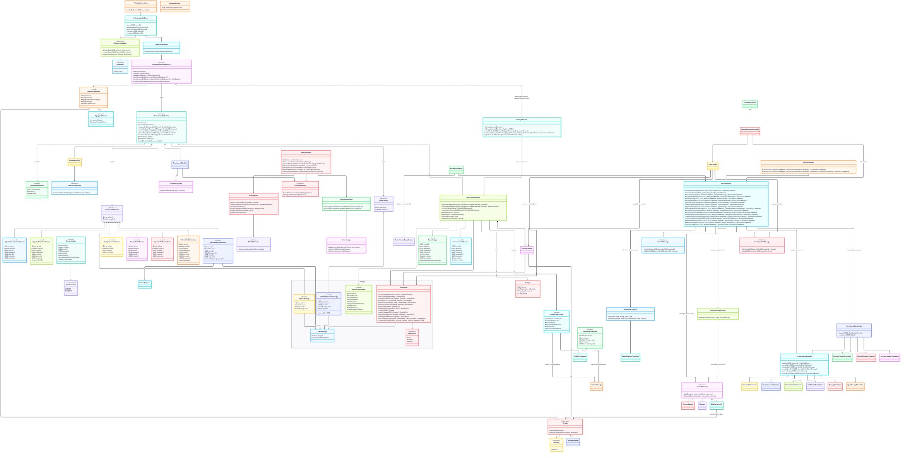

# Diagrammes de classes

Source : PRD (issue #2). Les noms de classes sont ceux du code Java, sans accents ; les concepts sont définis dans `GLOSSARY.md`. Les images PNG sont régénérées à partir des blocs Mermaid ci-dessous.

## Domaine

Les objets du domaine ; les captures immuables du Karaoké sont persistées par son service.

```mermaid
classDiagram
    direction TB

    class Lieu {
        +UUID id
        +String nom
        +String ville
    }
    class Animateur {
        +UUID id
        +String email
        +String motDePasseHache
        +String nom
    }
    class CleAssistant {
        +UUID id
        +String libelle
        +String empreinte
        +Instant creeeLe
        +Instant revoqueeLe
        +revoquer()
    }
    class Soiree {
        +UUID id
        +String codeAcces
        +String titre
        +Format format
        +Pilotage pilotage
        +EtatSoiree etat
        +Instant creeeLe
        +Instant debuteeLe
        +Instant termineeLe
        +ouvrir()
        +lancer()
        +terminer()
        +mancheEnCours() Manche
    }
    class Format {
        <<enumeration>>
        SOLO
        EQUIPE
    }
    class Pilotage {
        <<enumeration>>
        MANUEL
        AUTOMATIQUE
    }
    class EtatSoiree {
        <<enumeration>>
        PREPARATION
        OUVERTE
        EN_COURS
        TERMINEE
    }

    class Concurrent {
        <<interface>>
        +UUID id()
        +String nom()
    }
    class Joueur {
        +UUID id
        +String pseudo
        +String jetonReconnexion
        +Instant arriveLe
        +boolean exclu
        +exclure()
    }
    class Equipe {
        +UUID id
        +String nom
        +ajouterMembre(Joueur)
    }

    class Manche {
        <<abstract>>
        +UUID id
        +int ordre
        +ModeDeJeu mode
        +EtatManche etat
        +Duration tempsParEtape
        +Instant debuteeLe
        +Instant termineeLe
    }
    class ModeDeJeu {
        <<enumeration>>
        QUIZ
        BLIND_TEST
        KARAOKE
    }
    class EtatManche {
        <<enumeration>>
        PRETE
        EN_COURS
        EN_PAUSE
        TERMINEE
    }
    class Points {
        +UUID id
        +int valeur
        +String motif
        +Instant attribuesLe
    }

    class MancheQuiz {
        +List~String~ categories
        +Difficulte difficulte
        +int nombreDeQuestions
    }
    class Question {
        +UUID id
        +String enonce
        +String categorie
        +Difficulte difficulte
        +SourceQuestion source
    }
    class Proposition {
        +UUID id
        +String texte
        +boolean juste
        +int position
    }
    class QuestionDeManche {
        +int ordre
        +Instant poseeLe
    }
    class Reponse {
        +UUID id
        +Instant envoyeeLe
        +boolean juste
    }
    class Difficulte {
        <<enumeration>>
        FACILE
        MOYENNE
        DIFFICILE
    }
    class SourceQuestion {
        <<enumeration>>
        BANQUE
        ANIMATEUR
        IMPORT
        ASSISTANT
    }

    class MancheBlindTest {
        +String theme
        +Duration dureeExtrait
    }
    class Morceau {
        +UUID id
        +long idDeezer
        +String titre
        +String artiste
        +String urlPochette
    }
    class MorceauDeManche {
        +int ordre
        +Instant diffuseLe
    }
    class Buzz {
        +UUID id
        +Instant recuLe
        +int rang
    }
    class PropositionDeTitre {
        +UUID id
        +String texteSaisi
        +boolean titreTrouve
        +boolean artisteTrouve
        +Verdict verdict
    }
    class Verdict {
        <<enumeration>>
        ACCEPTE
        REFUSE
        RENVERSE_PAR_ANIMATEUR
    }

    class MancheKaraoke {
        +Duration delaiAppel
    }
    class Chanson {
        <<record>>
        +String chansonId
        +long idLrclib
        +String titre
        +String artiste
        +String album
        +Long dureeMs
        +EtatParoles etatParoles
    }
    class ContenuKaraoke {
        <<record>>
        +Chanson chanson
        +List~LigneParoles~ lignes
    }
    class LigneParoles {
        <<record>>
        +long positionMs
        +String texte
    }
    class LecturePassage {
        <<record>>
        +UUID lectureId
        +UUID passageId
        +UUID lecteurId
        +EtatLecture etat
        +SourceLecture source
        +FichierAudioLocal fichier
        +MotifParolesSeules motifParolesSeules
        +OrigineParoles origineParoles
        +ParolesDuPassage paroles
        +long versionSourceId
        +long decalageMs
        +long numeroModificationCalage
        +UUID demandeId
        +Instant demandeeLe
        ~passerA(EtatLecture) LecturePassage
        ~sansDemande() LecturePassage
        ~reprendreEnParolesSeules() LecturePassage
        ~avecCalage(long, UUID, Instant) LecturePassage
        ~dureeReferenceMs() long
    }
    class LecturePreparee {
        <<record>>
        +SourceLecture source
        +FichierAudioLocal fichier
        +MotifParolesSeules motifParolesSeules
        +OrigineParoles origineParoles
        +long dureeParolesMs
        +List~LigneParoles~ lignes
        +long versionSourceId
        +long decalageInitialMs
    }
    class FichierAudioLocal {
        <<record>>
        +String nom
        +long tailleOctets
        +Long dureeMs
    }
    class ParolesDuPassage {
        <<record>>
        +UUID parolesId
        +long dureeMs
        +List~LigneParoles~ lignes
        ~premierePosition() long
    }
    class EtatLecture {
        <<enumeration>>
        PREPAREE
        DEMARREE
        EN_ERREUR
    }
    class SourceLecture {
        <<enumeration>>
        FICHIER_LOCAL
        PAROLES_SEULES
    }
    class OrigineParoles {
        <<enumeration>>
        VERSION_ADAPTEE
        REPLI_INSCRIPTION
        INSCRIPTION
    }
    class MotifParolesSeules {
        <<enumeration>>
        FICHIER_ABSENT
        FICHIER_AMBIGU
        FICHIER_ILLISIBLE
        ECRAN_NON_PRET
        ERREUR_LECTURE
    }
    namespace passage {
        class FileAttente {
            +depuis(EtatFileAttente) FileAttente
            +etat() EtatFileAttente
            +ordreEffectif() List~Passage~
            +positions() Map
            +extraireProchainPassage(boolean) Optional~Passage~
            +trouver(UUID) Passage
            +appelerPassage(CiblePassage) ResultatFile
            ~appelerPassage(CiblePassage, Runnable) ResultatFile
            +demarrerPassage(CiblePassage) ResultatFile
            +clorePassage(CiblePassage, EtatPassage, TraceTerminale) ResultatFile
        }
        class CycleDePassage {
            +CycleDePassage(FileAttente, Horloge, Duration, EtatCyclePassage, Consumer~CloturePassage~)
            +etat() EtatCyclePassage
            +courantActif() Passage
            +appeler(CiblePassage, UUID, Instant) ResultatFile
            +appeler(CiblePassage, Instant, Supplier~UUID~) ResultatFile
            +appelerSuivantSiLibre(Supplier~UUID~, Instant) boolean
            +demarrer(CiblePassage, UUID, Duration, Instant) ResultatFile
            +clore(EtatPassage, String, UUID, Instant) ResultatFile
            +suspendre(Instant)
            +reprendre(Instant)
            +reprogrammerFin()
            +projeter(EtatFileAttente, EtatCyclePassage, boolean, Instant) ProjectionCycle
        }
        class EtatCyclePassage {
            <<record>>
            +UUID passageId
            +UUID etapeId
            +Instant appeleLe
            +Instant echeanceAppelLe
            +Instant demarreLe
            +Duration dureeReference
            +Duration tempsPause
            +Instant pauseDepuis
            +Instant clotureLe
            +vide() EtatCyclePassage
            ~finPrevue() Instant
        }
        class ProjectionCycle {
            <<record>>
            +Passage courant
            +boolean actif
            +String etat
            +UUID etapeId
            +Instant appeleLe
            +Instant echeanceAppelLe
            +Long delaiAppelRestantMs
            +Instant demarreLe
            +Instant finPrevueLe
            +Long positionChronologiqueMs
            +long tempsPauseMs
            +Instant clotureLe
            +Instant prochainAppelPrevuLe
            +Instant calculeLe
        }
        class CloturePassage {
            <<record>>
            +UUID passageId
            +UUID etapeId
            +EtatPassage etat
            +String motif
            +Instant instant
        }
        class Passage {
            <<record>>
            +UUID id
            +UUID soireeId
            +UUID mancheId
            +UUID inscripteurId
            +List~UUID~ interpretes
            +String contenuId
            +Duration duree
            +long numero
            +long numeroModification
            +EtatPassage etat
            +Instant inscriptionLe
            +long ordreInscription
            +long tourNormal
            +long cleOrdre
            +Long tourConsomme
            +TraceTerminale traceTerminale
        }
        class EtatPassage {
            <<enumeration>>
            EN_ATTENTE
            RETIRE
            ANNULE
            APPELE
            EN_COURS
            TERMINE
            SAUTE
        }
        class EtatFileAttente {
            <<record>>
            +long limitePassagesEnAttente
            +long tourOuvert
            +long prochainOrdreInscription
            +long prochaineCleOrdre
            +UUID passagePrioritaireId
            +List~Passage~ passages
            +Map derniersToursConsommes
        }
        class TraceTerminale {
            <<record>>
            +String motif
            +UUID acteurId
            +Instant instant
        }
        class VoteDuPublic
        class EtatVoteDuPublic {
            <<record>>
            +List~EtatVotePassage~ votes
        }
        class EtatVotePassage {
            <<record>>
            +UUID passageId
            +Instant ouvertLe
            +Instant echeanceLe
            +Instant pauseDepuis
            +Instant clotureLe
            +List~VoteRecu~ votes
        }
        class VoteRecu {
            <<record>>
            +UUID joueurId
            +int note
            +Instant recueLe
        }
        class ResultatVote {
            <<record>>
            +UUID passageId
            +UUID mancheId
            +long numero
            +List~UUID~ interpretes
            +long nombreVotes
            +long sommeNotes
            +Integer moyenneDixiemes
        }
        class RangPassage {
            <<record>>
            +ResultatVote resultat
            +Long rang
        }
        class ClassementParVote {
            +classer(List~ResultatVote~) List~RangPassage~
        }
    }

    Lieu "1" --> "1..*" Animateur : emploie
    Lieu "1" --> "*" Soiree : organise
    Lieu "1" --> "*" CleAssistant : autorise
    Animateur "1" --> "*" Soiree : crée
    Soiree "1" *-- "*" Manche : enchaîne
    Soiree "1" *-- "*" Joueur : accueille
    Soiree "1" *-- "*" Equipe : regroupe
    Equipe "0..1" o-- "1..*" Joueur : membres
    Concurrent <|.. Joueur
    Concurrent <|.. Equipe
    Manche "1" *-- "*" Points : attribue
    Points "*" --> "1" Concurrent : bénéficiaire

    Manche <|-- MancheQuiz
    Manche <|-- MancheBlindTest
    Manche <|-- MancheKaraoke

    MancheQuiz "1" *-- "*" QuestionDeManche
    QuestionDeManche "*" --> "1" Question
    Question "1" *-- "4" Proposition
    QuestionDeManche "1" *-- "*" Reponse
    Reponse "*" --> "1" Joueur : auteur
    Reponse "*" --> "1" Proposition : choisie

    MancheBlindTest "1" *-- "*" MorceauDeManche
    MorceauDeManche "*" --> "1" Morceau
    MorceauDeManche "1" *-- "*" Buzz
    Buzz "*" --> "1" Joueur : auteur
    Buzz "1" --> "0..1" PropositionDeTitre

    MancheKaraoke "1" *-- "1" FileAttente
    MancheKaraoke "1" *-- "1" CycleDePassage
    MancheKaraoke "1" *-- "0..1" LecturePassage : indexée par passageId
    CycleDePassage --> FileAttente : état et compteur
    CycleDePassage "1" *-- "1" EtatCyclePassage : chronologie
    CycleDePassage ..> ProjectionCycle : projette
    CycleDePassage ..> CloturePassage : notifie
    ProjectionCycle --> "0..1" Passage : courant affiché
    CloturePassage --> EtatPassage
    FileAttente "1" *-- "*" Passage : conserve tous les états
    FileAttente ..> EtatFileAttente : capture
    Passage "*" --> "1..4" Joueur : Interprètes ordonnés
    Passage --> EtatPassage
    Passage "1" *-- "0..1" TraceTerminale
    MancheKaraoke "1" *-- "*" ContenuKaraoke : indexé par passageId
    ContenuKaraoke --> Chanson
    ContenuKaraoke "1" *-- "*" LigneParoles
    LecturePassage --> EtatLecture
    LecturePassage --> SourceLecture
    LecturePassage --> OrigineParoles
    LecturePassage --> "0..1" MotifParolesSeules
    LecturePassage "1" *-- "0..1" FichierAudioLocal
    LecturePassage "1" *-- "1" ParolesDuPassage
    ParolesDuPassage "1" *-- "1..*" LigneParoles
    LecturePreparee ..> LecturePassage : prépare
    LecturePreparee --> SourceLecture
    LecturePreparee --> OrigineParoles
    LecturePreparee --> "0..1" MotifParolesSeules
    LecturePreparee --> "0..1" FichierAudioLocal
    LecturePreparee --> LigneParoles
    MancheKaraoke "1" *-- "1" VoteDuPublic
    CycleDePassage ..> VoteDuPublic : ouverture à la clôture TERMINE
    VoteDuPublic ..> EtatVoteDuPublic : capture
    EtatVoteDuPublic "1" *-- "*" EtatVotePassage
    EtatVotePassage "0..1" --> "1" Passage : Passage noté
    EtatVotePassage "1" *-- "*" VoteRecu
    VoteRecu "*" --> "1" Joueur : votant
    ResultatVote ..> EtatVotePassage : résultat du vote clos
    RangPassage --> ResultatVote
    ClassementParVote ..> RangPassage : attribue
```




## Services du socle et des modes

Le contrat de Manche (package `manche`) : chaque Mode de jeu fournit une `FabriqueDeDeroulement`, qui crée un `DeroulementDeManche` par Manche. Les ports vers l'extérieur sont en bas.

```mermaid
classDiagram
    direction TB

    class FabriqueDeDeroulement~R,E~ {
        <<interface>>
        +ModeDeJeu mode()
        +Class~R~ typeReglages()
        +ReglagesDeManche reglagesCommuns(R)
        +DeroulementDeManche creer(ContexteDeManche, R)
        +DeroulementDeManche restaurer(ContexteDeManche, R, E, EtatManche)
        +String typeEvenementMinuteur(DeroulementDeManche)
    }
    class DeroulementDeManche {
        <<interface>>
        +demarrer()
        +recevoir(ActionJoueur)
        +commander(CommandeDeManche) ResultatDeCommande
        +mettreEnPause(CommandePilotage) ResultatDeCommande
        +reprendre(CommandePilotage) ResultatDeCommande
        +passerEtape(CommandePilotage) ResultatDeCommande
        +terminer(CommandePilotage) ResultatDeCommande
        +instantane() Object
        +boolean estTerminee()
        +List~AttributionDePoints~ points()
    }
    class ContexteDeManche {
        <<record>>
        +UUID soireeId
        +UUID mancheId
        +ReglagesDeManche reglages
        +Horloge horloge
        +Runnable signalerFin
    }
    class ReglagesDeManche {
        <<record>>
        +int nombreEtapes
        +Duration tempsParEtape
    }
    class AttributionDePoints {
        <<record>>
        +UUID concurrentId
        +int valeur
        +String motif
    }
    class ActionJoueur {
        <<interface>>
        +UUID joueurId()
        +Instant recueLe()
    }
    class Horloge {
        <<interface>>
        +Instant maintenant()
        +Minuteur programmer(Duration, Runnable)
    }
    class Minuteur {
        <<interface>>
        +annuler()
    }
    class HorlogeSysteme
    class DiffuseurTempsReel {
        <<interface>>
        +diffuserSalle(UUID soireeId, Evenement)
        +envoyerJoueur(UUID joueurId, Evenement)
        +envoyerConsole(UUID soireeId, Evenement)
    }
    class Evenement {
        <<interface>>
        +String type()
    }

    class ServiceSoiree {
        +Soiree creer(Animateur, Format, Pilotage)
        +ajouterManche(UUID soireeId, ModeDeJeu, ReglagesDeManche)
        +ouvrir(UUID soireeId)
        +Joueur rejoindre(String codeAcces, String pseudo)
        +Joueur reconnecter(String jeton)
        +exclure(UUID joueurId)
    }
    class ServiceEquipe {
        +Equipe creer(UUID soireeId, String nom, Joueur)
        +rejoindre(UUID equipeId, Joueur)
        +Concurrent concurrentDe(Joueur)
    }
    class OrchestrateurDeSoiree {
        +lancer(UUID soireeId)
        +mancheSuivante(UUID soireeId)
        +mettreEnPause(UUID soireeId)
        +reprendre(UUID soireeId)
        +terminer(UUID soireeId)
    }
    class PilotageAutomatique {
        +surFinDeManche(UUID mancheId)
    }
    class RegistreDesModes {
        +FabriqueDeDeroulement pour(ModeDeJeu)
    }
    class ServiceClassement {
        +List~LigneClassement~ classementGeneral(UUID soireeId)
    }
    class FiltreDePseudos {
        <<interface>>
        +boolean estAcceptable(String pseudo)
    }

    class OutilsAssistant {
        +List~Soiree~ listerSoirees()
        +Soiree creerSoiree(titre, Format, Pilotage)
        +ajouterManche(UUID soireeId, ModeDeJeu, ReglagesDeManche)
        +ajouterQuestions(UUID mancheId, List~Question~)
        +List~Morceau~ chercherMorceaux(String requete)
        +ajouterMorceaux(UUID mancheId, List~Long~ idsDeezer)
        +List~LigneClassement~ consulterClassement(UUID soireeId)
    }
    class DeroulementQuiz
    class DeroulementBlindTest
    class DeroulementKaraoke {
        +DeroulementKaraoke(ContexteDeManche, ReglagesKaraoke, Duration)
        +DeroulementKaraoke(ContexteDeManche, ReglagesKaraoke, Duration, Duration, Supplier~UUID~)
        +recevoir(ActionJoueur) ResultatDeCommande
        +commander(CommandeDeManche) ResultatDeCommande
        +viseEtape(UUID) boolean
        +instantane() InstantaneKaraoke
        +estimerAttentes() Map
        +causeDernierMinuteur() String
    }
    class SourceDeQuestions {
        <<interface>>
        +List~Question~ tirer(categories, Difficulte, int nombre)
    }
    class CatalogueMusical {
        <<interface>>
        +List~Morceau~ rechercher(String requete)
        +String lienExtrait(long idDeezer)
    }
    class SourceDeParoles {
        <<interface>>
        +List~Chanson~ rechercher(String recherche)
        +Optional~ContenuKaraoke~ charger(long idLrclib)
    }
    class AdaptateurLrclib
    class ServiceDeManche {
        +executer(UUID, EnvoiDeCommande, Supplier~PreparationDeCommande~) ResultatDeCommande
        #executer(UUID, EnvoiDeCommande, Supplier~PreparationDeCommande~, EtatManche etatApresAcceptation) ResultatDeCommande
    }
    class ServiceKaraoke {
        +palmaresKaraoke(UUID soireeId) List~LignePalmaresKaraoke~
        +rechercherChansons(Acteur, UUID, UUID, String, UUID) ResultatsChansons
        +consulterChanson(Acteur, UUID, UUID, String) FicheChanson
        +inscrirePassage(UUID, EnvoiDeCommande, InscriptionPassage) ResultatDeCommande
        +desinscrirePassage(UUID, UUID, EnvoiDeCommande, DesinscriptionPassage) ResultatDeCommande
        +voterPassage(UUID, UUID, EnvoiDeCommande, VotePassage) ResultatDeCommande
        +retirerPassage(UUID, UUID, EnvoiDeCommande, RetraitPassage) ResultatDeCommande
        +deplacerPassage(UUID, UUID, EnvoiDeCommande, PlacementPassage) ResultatDeCommande
        +definirPrioritePassage(UUID, EnvoiDeCommande, PrioritePassage) ResultatDeCommande
        +reglerLimitePassages(UUID, EnvoiDeCommande, LimitePassages) ResultatDeCommande
        +appelerPassage(UUID, UUID, EnvoiDeCommande, AppelPassage) ResultatDeCommande
        +confirmerPresencePassage(UUID, UUID, EnvoiDeCommande, ConfirmationPresencePassage) ResultatDeCommande
        +designerLecteurChanson(UUID, EnvoiDeCommande, DesignationLecteur) ResultatDeCommande
        +declarerLectureChanson(UUID, UUID, EnvoiDeCommande, DeclarationLectureChanson) ResultatDeCommande
        +signalerFinLectureChanson(UUID, UUID, EnvoiDeCommande, SignalFinLectureChanson) ResultatDeCommande
        +signalerErreurLectureChanson(UUID, UUID, EnvoiDeCommande, SignalErreurLectureChanson) ResultatDeCommande
        +releverPositionLecture(UUID, UUID, EnvoiDeCommande, RelevePositionLecture) ResultatDeCommande
        +reprendreEnParolesSeules(UUID, UUID, EnvoiDeCommande, RepriseParolesSeules) ResultatDeCommande
        +marquerDebutParoles(UUID, UUID, EnvoiDeCommande, MarqueDebutParoles) ResultatDeCommande
        +corrigerCalage(UUID, UUID, EnvoiDeCommande, CorrectionCalage) ResultatDeCommande
    }
    class KaraokeControleur
    class ConvertisseurCorpsKaraoke
    class FournisseurDeBlocKaraoke
    class FournisseurDeChampCommun {
        <<interface>>
        +champ() String
        +concerne(Destination) boolean
        +fournir(UUID, Destination, Map) Object
    }
    class AssembleurDeVues
    class FournisseurPalmaresKaraoke
    class VuesKaraoke
    class VoteDuPassage
    class VoteDuPassageManette
    class LignePalmaresKaraoke
    class PersistanceKaraokeJpa {
        +charger(UUID) EtatKaraokePersiste
        +enregistrer(UUID, Object)
        +contenus(Collection~UUID~) Map
    }
    class ChoixDeVersionParoles {
        +choisir(ContenuKaraoke, long) ResultatChoix
    }
    class MemoireDeCalageJpa {
        +lire(String, long, String, long) long
        +memoriser(String, long, FichierAudioLocal, long, Instant)
    }
    class LecteurChansonPersistant
    class LecturePassagePersistante
    class CalageChansonPersistant
    class CyclePassagePersistant
    class PersistancePassageJpa {
        +charger(UUID mancheId) EtatFileAttente
        +enregistrer(UUID mancheId, EtatFileAttente)
        +chargerCycle(UUID mancheId) EtatCyclePassage
        +enregistrerCycle(UUID mancheId, EtatCyclePassage)
        +chargerVotes(UUID mancheId) EtatVoteDuPublic
        +enregistrerVotes(UUID mancheId, EtatVoteDuPublic)
        +resultatsDeVote(Collection~UUID~) List~ResultatVote~
        +numeroPropose(UUID soireeId) long
        +incrementerNumero(UUID soireeId, long numeroAccepte)
    }
    class ContenuPassagePersistant
    class FileAttentePersistante
    class PassagePersistant
    class InterpretePersistant
    class TourConsommePersistant
    class NumeroSoireePersistant
    class PorteeDePassage {
        <<interface>>
        +verifier(Acteur, UUID soireeId, UUID mancheId)
        +estActive(UUID soireeId, UUID mancheId) boolean
    }
    class ParticipantsDePassage {
        <<interface>>
        +estPresent(UUID soireeId, UUID joueurId) boolean
        +pseudos(UUID soireeId) Map
    }
    class PorteeDePassageSoiree
    class ParticipantsDePassageSoiree
    class EtatDeSoiree {
        <<interface>>
        +estEnCours(UUID soireeId) boolean
        +estTerminee(UUID soireeId) boolean
    }
    class EtatDeSoireeEnregistree
    class CorrecteurTolerant {
        +Verdict juger(String saisie, Morceau)
    }
    class FabriqueKaraoke {
        +FabriqueKaraoke(Duration)
        +FabriqueKaraoke(Duration, Duration, Supplier~UUID~)
        +creer(ContexteDeManche, ReglagesKaraoke) DeroulementKaraoke
        +restaurer(ContexteDeManche, ReglagesKaraoke, EtatKaraokePersiste, EtatManche) DeroulementKaraoke
        +typeEvenementMinuteur(DeroulementDeManche) String
    }
    class ReglagesKaraoke {
        +long limitePassagesEnAttente
    }
    class InstantaneKaraoke {
        <<record>>
        +EtatManche etatManche
        +EtatFileAttente file
        +Map contenus
        +EtatCyclePassage cycle
        +Map lectures
        +UUID lecteurDesigneId
        +EtatVoteDuPublic voteDuPublic
        +boolean pilotageAutomatique
    }
    class EtatKaraokePersiste {
        <<record>>
        +EtatFileAttente file
        +Map contenus
        +EtatCyclePassage cycle
        +Map lectures
        +UUID lecteurDesigneId
        +EtatVoteDuPublic voteDuPublic
    }
    class CommandeDeManche {
        <<interface>>
        +Acteur acteur()
        +Instant recueLe()
    }
    class Accepte {
        +Object accuse
        +Set~Destination~ aRepublier
        +String typeEvenement
        +int statutHttp
    }
    class DesignerLecteurChanson {
        <<record>>
        +Acteur acteur
        +Instant recueLe
        +UUID envoiId
        +UUID lecteurId
    }
    class DeclarerLectureChanson {
        <<record>>
        +Acteur acteur
        +Instant recueLe
        +UUID envoiId
        +CiblePassage cible
        +UUID etapeId
        +UUID lecteurId
        +LecturePreparee preparation
    }
    class SignalerFinLectureChanson {
        <<record>>
        +Acteur acteur
        +Instant recueLe
        +UUID envoiId
        +UUID passageId
        +UUID etapeId
        +UUID lectureId
        +UUID lecteurId
        +long positionMs
    }
    class SignalerErreurLectureChanson {
        <<record>>
        +Acteur acteur
        +Instant recueLe
        +UUID envoiId
        +UUID passageId
        +UUID etapeId
        +UUID lectureId
        +UUID lecteurId
    }
    class ReprendreEnParolesSeules {
        <<record>>
        +Acteur acteur
        +Instant recueLe
        +UUID envoiId
        +UUID passageId
        +UUID etapeId
        +UUID lectureId
    }
    class MarquerDebutParoles {
        <<record>>
        +Acteur acteur
        +Instant recueLe
        +UUID envoiId
        +UUID passageId
        +UUID etapeId
        +UUID lectureId
    }
    class CorrigerCalage {
        <<record>>
        +Acteur acteur
        +Instant recueLe
        +UUID envoiId
        +UUID passageId
        +UUID etapeId
        +UUID lectureId
        +long numeroModificationCalage
        +SensCorrection sens
    }
    class ReleverPositionLecture {
        <<record>>
        +Acteur acteur
        +Instant recueLe
        +UUID envoiId
        +UUID passageId
        +UUID etapeId
        +UUID lectureId
        +UUID lecteurId
        +UUID demandeId
        +long positionMs
    }
    class AccuseLectureChanson {
        <<record>>
        +UUID envoiId
        +UUID soireeId
        +UUID mancheId
        +UUID lecteurId
        +UUID passageId
        +UUID lectureId
        +String action
        +Instant recueLe
    }
    class AccuseCalage {
        <<record>>
        +UUID envoiId
        +UUID soireeId
        +UUID mancheId
        +UUID passageId
        +UUID lectureId
        +String action
        +Instant recueLe
        +UUID demandeId
        +long numeroModificationCalage
    }
    class SensCorrection {
        <<enumeration>>
        AVANCER
        RETARDER
    }
    namespace passage {
        class VoteDuPublic {
            +ouvrir(UUID, Instant, boolean)
            +voter(UUID, CiblePassage, int, Instant, boolean) Optional~Refuse~
            +suspendre(Instant)
            +reprendre(Instant)
            +cloreTout(Instant)
            +reprogrammer(Instant)
            +aUnVoteOuvert() boolean
            +etat() EtatVoteDuPublic
            +projeter(EtatVotePassage, Instant) ProjectionVote
        }
        class VoterPassage {
            <<record>>
            +Acteur acteur
            +Instant recueLe
            +UUID envoiId
            +CiblePassage cible
            +int note
        }
        class AccuseVote {
            <<record>>
            +UUID envoiId
            +UUID soireeId
            +UUID mancheId
            +UUID passageId
            +int note
            +Instant recueLe
        }
        class ClotureVote
        class ProjectionVote
        class ClassementParVote
        class VotePersistant
        class NotePersistante
        class FileAttente {
            +verifierInscription(UUID, String) Optional~Refuse~
            +inscrire(NouveauPassage) ResultatFile
            +desinscrire(UUID, CiblePassage, Instant) ResultatFile
            +retirer(UUID, CiblePassage, Instant) ResultatFile
            +deplacer(CiblePassage, long, CiblePassage) ResultatFile
            +definirPriorite(CiblePassage, boolean) ResultatFile
            +reglerLimite(long) ResultatFile
            +annulerAttentes(Instant, UUID) ResultatFile
            +trouver(UUID) Passage
            +appelerPassage(CiblePassage) ResultatFile
            ~appelerPassage(CiblePassage, Runnable) ResultatFile
            +demarrerPassage(CiblePassage) ResultatFile
            +clorePassage(CiblePassage, EtatPassage, TraceTerminale) ResultatFile
            +estimerAttentes(Instant, boolean, Instant, boolean, Duration) Map
        }
        class AppelerPassage {
            <<record>>
            +Acteur acteur
            +Instant recueLe
            +UUID envoiId
            +CiblePassage cible
        }
        class ConfirmerPresencePassage {
            <<record>>
            +Acteur acteur
            +Instant recueLe
            +UUID envoiId
            +CiblePassage cible
            +UUID etapeId
            +joueurId() UUID
        }
        class AccuseCyclePassage {
            <<record>>
            +UUID envoiId
            +UUID soireeId
            +UUID mancheId
            +UUID passageId
            +UUID etapeId
            +long numeroModification
            +String action
            +Instant recueLe
            +EtatPassage etatApres
        }
        class CiblePassage {
            +UUID passageId
            +long numeroModification
        }
        class ResultatFile {
            <<interface>>
            Refus
            SansEffet
            Modifiee
        }
    }

    FabriqueDeDeroulement ..> DeroulementDeManche : crée
    FabriqueDeDeroulement ..> ContexteDeManche
    ContexteDeManche --> ReglagesDeManche
    ContexteDeManche --> Horloge
    DeroulementDeManche ..> ActionJoueur : reçoit
    DeroulementDeManche ..> AttributionDePoints : produit
    Horloge ..> Minuteur
    Horloge <|.. HorlogeSysteme
    DiffuseurTempsReel ..> Evenement

    DeroulementDeManche <|.. DeroulementQuiz
    DeroulementDeManche <|.. DeroulementBlindTest
    DeroulementDeManche <|.. DeroulementKaraoke

    OrchestrateurDeSoiree --> RegistreDesModes
    OrchestrateurDeSoiree --> DiffuseurTempsReel
    PilotageAutomatique --> OrchestrateurDeSoiree
    RegistreDesModes o-- FabriqueDeDeroulement
    ServiceSoiree --> FiltreDePseudos
    ServiceClassement ..> ServiceEquipe

    OutilsAssistant --> ServiceSoiree
    OutilsAssistant --> CatalogueMusical
    OutilsAssistant --> ServiceClassement
    DeroulementQuiz --> SourceDeQuestions
    DeroulementBlindTest --> CatalogueMusical
    DeroulementBlindTest --> CorrecteurTolerant
    DeroulementKaraoke --> FileAttente
    DeroulementKaraoke "1" *-- "1" CycleDePassage
    CycleDePassage --> Horloge
    CycleDePassage --> FileAttente
    DeroulementKaraoke "1" *-- "1" VoteDuPublic
    VoteDuPublic --> Horloge
    VoteDuPublic --> FileAttente
    VoteDuPublic ..> ClotureVote : notifie le déroulement
    VoteDuPublic ..> ProjectionVote : projette
    InstantaneKaraoke --> EtatVoteDuPublic
    EtatKaraokePersiste --> EtatVoteDuPublic
    ActionJoueur <|.. VoterPassage
    VoterPassage --> CiblePassage
    DeroulementKaraoke ..> AccuseVote
    InstantaneKaraoke --> EtatCyclePassage
    InstantaneKaraoke --> LecturePassage : indexée par passageId
    EtatKaraokePersiste --> EtatCyclePassage
    EtatKaraokePersiste --> LecturePassage : indexée par passageId
    ActionJoueur <|.. ConfirmerPresencePassage
    CommandeDeManche <|.. AppelerPassage
    CommandeDeManche <|.. DesignerLecteurChanson
    CommandeDeManche <|.. DeclarerLectureChanson
    CommandeDeManche <|.. SignalerFinLectureChanson
    CommandeDeManche <|.. SignalerErreurLectureChanson
    CommandeDeManche <|.. ReprendreEnParolesSeules
    CommandeDeManche <|.. MarquerDebutParoles
    CommandeDeManche <|.. CorrigerCalage
    CommandeDeManche <|.. ReleverPositionLecture
    AppelerPassage --> CiblePassage
    ConfirmerPresencePassage --> CiblePassage
    DeclarerLectureChanson --> CiblePassage
    DeclarerLectureChanson --> LecturePreparee
    CorrigerCalage --> SensCorrection
    DeroulementKaraoke ..> AccuseCyclePassage
    DeroulementKaraoke ..> AccuseLectureChanson
    DeroulementKaraoke ..> AccuseCalage
    ServiceDeManche <|-- ServiceKaraoke
    KaraokeControleur --> ServiceKaraoke
    KaraokeControleur ..> ConvertisseurCorpsKaraoke : liaison avant identité
    ServiceKaraoke --> PorteeDePassage
    ServiceKaraoke --> ParticipantsDePassage
    ServiceKaraoke --> PersistancePassageJpa : numéro sous verrou
    ServiceKaraoke --> SourceDeParoles : catalogue hors verrou
    ServiceKaraoke --> ChoixDeVersionParoles : prépare hors verrou
    ChoixDeVersionParoles --> SourceDeParoles : sélectionne la version
    ServiceKaraoke --> MemoireDeCalageJpa : lit et écrit sous verrou
    MemoireDeCalageJpa --> CalageChansonPersistant
    ServiceKaraoke --> PersistanceKaraokeJpa : transaction commune
    PersistanceKaraokeJpa --> PersistancePassageJpa
    PersistanceKaraokeJpa --> ContenuPassagePersistant
    PersistanceKaraokeJpa --> LecturePassagePersistante
    PersistanceKaraokeJpa --> LecteurChansonPersistant
    PersistancePassageJpa --> VotePersistant
    PersistancePassageJpa --> NotePersistante
    VotePersistant "1" --> "*" NotePersistante : clé du Passage
    PersistancePassageJpa --> CyclePassagePersistant
    PersistancePassageJpa --> FileAttentePersistante
    PersistancePassageJpa --> PassagePersistant
    PersistancePassageJpa --> InterpretePersistant
    PersistancePassageJpa --> TourConsommePersistant
    PersistancePassageJpa --> NumeroSoireePersistant
    FournisseurDeBloc <|.. FournisseurDeBlocKaraoke
    FournisseurDeBlocKaraoke --> ServiceKaraoke : instantané
    AssembleurDeVues o-- FournisseurDeChampCommun : champs de la vue
    FournisseurDeChampCommun <|.. FournisseurPalmaresKaraoke
    FournisseurPalmaresKaraoke --> ServiceKaraoke : Palmarès
    ServiceKaraoke ..> ClassementParVote
    ServiceKaraoke ..> LignePalmaresKaraoke
    FournisseurDeBlocKaraoke --> VuesKaraoke
    VuesKaraoke --> ParticipantsDePassage : pseudos publics
    PorteeDePassage <|.. PorteeDePassageSoiree : soiree, Soirée en base
    ParticipantsDePassage <|.. ParticipantsDePassageSoiree : soiree, Joueurs en base
    EtatDeSoiree <|.. EtatDeSoireeEnregistree : soiree
    VuesKaraoke --> FileAttente : ordre et estimations
    VuesKaraoke ..> CycleDePassage : projette le courant
    VuesKaraoke ..> VoteDuPublic : projette le vote
    VuesKaraoke ..> VoteDuPassage : Console
    VuesKaraoke ..> VoteDuPassageManette : note personnelle
    SourceDeParoles <|.. AdaptateurLrclib
    SourceDeParoles ..> Chanson
    SourceDeParoles ..> ContenuKaraoke
    AdaptateurLrclib --> Horloge : attente Retry-After
    FabriqueDeDeroulement <|.. FabriqueKaraoke : R=ReglagesKaraoke, E=EtatKaraokePersiste
    FabriqueKaraoke ..> DeroulementKaraoke : crée ou restaure
    DeroulementKaraoke ..> InstantaneKaraoke : capture
    DeroulementKaraoke ..> Accepte : rend
    DeroulementDeManche ..> CommandeDeManche : reçoit
    FileAttente ..> CiblePassage
    FileAttente ..> ResultatFile
```



## Régénérer les images

Depuis la racine, extraire les deux blocs Mermaid dans des fichiers temporaires :

```sh
python3 - <<'PYTHON'
from pathlib import Path
source = Path("docs/conception/diagrammes-de-classes.md").read_text()
blocs = [partie.split("```", 1)[0].strip() for partie in source.split("```mermaid\n")[1:]]
for nom, bloc in zip(("domaine", "services"), blocs):
    Path(f"/tmp/croustyquizz-{nom}.mmd").write_text(bloc + "\n")
PYTHON
npx --yes --package @mermaid-js/mermaid-cli mmdc -s 3 -i /tmp/croustyquizz-domaine.mmd -o docs/conception/diagramme-classes-domaine.png
npx --yes --package @mermaid-js/mermaid-cli mmdc -s 3 -i /tmp/croustyquizz-services.mmd -o docs/conception/diagramme-classes-services.png
```

Si le bac à sable impose un Chrome sans sandbox, ajouter `-p /tmp/croustyquizz-puppeteer.json` aux deux commandes, avec `{"args":["--no-sandbox"]}` dans ce fichier temporaire. Vérifier visuellement les deux PNG après génération.
